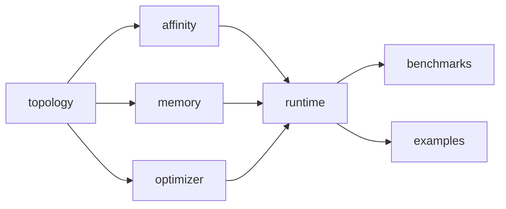

# Architecture

## Modules and dependencies



| module | responsibility | notable classes |
|---|---|---|
| `topology` | what the machine is, and what *this process* may use | `NumaTopology`, `NumaNode`, `CpuTopology`, `TopologyDiscovery`, `CpuList` |
| `affinity` | pin the calling thread; verify; avoid shared cores | `CpuAffinity` (+`LinuxCpuAffinity` over FFM, `SimulatedCpuAffinity`), `PinnedThreadFactory`, `AffinityVerifier` |
| `memory` | NUMA-bound off-heap memory and proof of where it is | `NumaAllocator`, `NumaMemoryRegion`, `NumaMemoryVerifier`, `NumaMapsReader`, `PayloadSlab` |
| `optimizer` | graph, cost model, placement algorithms | `CommunicationGraph`, `PlacementCostModel`, `*PlacementOptimizer`, `PlacementPlan`, `ManualPlacement` |
| `runtime` | build and run the pipeline from a plan | `NumaEventProcessor`, `PlacementManager`, `NumaDisruptorFactory`, `ProducerScheduler`, `CrossNodeBridge`, `EventRouter`, event model + verifiers |
| `benchmarks` | end-to-end harness, matrices, metrics, JMH | `HarnessMain`, `ExperimentRunner`, `PlacementFactory`, `TradingWorkload`, `Matrices` |
| `examples` | smallest useful usage | `TradingDemo` |

There are no cycles; `topology` is the only module every other one shares, and it has no dependencies. The optimizer knows
nothing about threads or the Disruptor (it works on an abstract graph), and the runtime is the only place that turns a
plan into threads and rings.

## Topology and affinity

`TopologyDiscovery.discover(sysRoot, procStatus, cgroupFile)` takes its three inputs as parameters so the parser is tested against
fabricated directory trees; `discover()` binds them to the real paths. `NumaTopology` separates the **hardware layout** (nodes,
CPUs, sockets, cores, SMT siblings, distance matrix) from the **allowed masks** (`allowedCpus`, `allowedNodes`) and exposes
only helpers that respect the masks. A synthetic builder (`NumaTopology.synthetic`, `epyc7513DualSocket`) backs the tests; its
SMT pairing is an assumption and it is never used as a substitute for discovery on real hardware.

`CpuAffinity.pinCurrentThread` calls `sched_setaffinity(0, …)` from the thread being pinned: pid 0 means the calling kernel
thread, so only that worker is affected (verified by a test that pins a child and checks the parent's mask is unchanged).
Virtual threads are rejected. `PinnedThreadFactory` makes threads that pin themselves and verify the result before running
their task; a failure is recorded and the task never runs, so a half-pinned system cannot start.

## Communication graph and cost model

Vertices: `PRODUCER`, `CONSUMER`, `STAGE` (workers, 1 dedicated CPU each) and `RING_BUFFER`, `SEQUENCER_METADATA`,
`GATING_SEQUENCE` (memory). The latter three of one ring share a *colocation group*: they are allocated together and move together.

A directed edge `from -> to` means *from* is the actor and *to* is the thing it touches, so direction encodes read/write:

| `EdgeKind` | meaning | weight |
|---|---|---|
| `PAYLOAD_WRITE` | actor writes event data into memory homed at target | `events/s × ceil(payload/64) × coefficient` |
| `PAYLOAD_READ` | actor reads event data from memory homed at target | same, read coefficient |
| `OWNERSHIP_TRANSFER` | a sequencing cache line moves between the cores | `events/s ÷ eventsPerHandoff × linesPerHandoff × coefficient` |

Batching enters through `eventsPerHandoff`: a consumer that takes 8 events per batch generates an eighth of the cursor traffic.
`PlacementCostModel` turns weights into cost with `excessDistance(a, b) = D(a,b)/D(a,a) − 1` (0 when local). Its defaults are
priors (`read 1.0, write 0.8, ownership 2.5`); `fromLatencyMatrix` replaces the Linux distances with measured ones. The runtime
fills in the graph from the `WorkloadSpec` (`WorkloadGraphBuilder`), including the assumption that a producer re-reads
consumer progress about once per half ring when consumers keep up; these rates are estimates by construction.

## Optimizers

`ClusterProblem` reduces a graph to clusters and per-node capacities (CPUs: allowed, non-reserved, cores before SMT siblings;
memory: node `MemTotal`; per-vertex node whitelists). All optimizers share it so they agree on feasibility, and every plan is
re-validated by `PlacementPlan.validate` before being returned. Infeasible inputs raise `InfeasiblePlacementException` with the
reason (for example "workload needs 24 dedicated cpus but only 16 are available") instead of being squeezed in. Ordering inside
every algorithm is by vertex id, so output is independent of insertion order.

`GreedyPlacementOptimizer`: connected components of the graph are independent event streams; heaviest first, each goes whole to
the node where it fits with least leftover capacity (best fit); only a component larger than any node is split, cluster by
cluster, onto the node adding least cost against what is already placed. `LocalSearchOptimizer` then applies relocate and swap
moves whose cost decrease exceeds 1e-9 until none exists.

## Runtime

```
partition p:  producers ─► ring0 ─► forwarder0 ─► ring1 ─► … ─► ring{F} ─► consumers (N)
                           (SINGLE or MULTI)   (bridge)   (SINGLE)         MULTICAST | WORK_DISTRIBUTION
```
* **Who creates workers.** `NumaEventProcessor` does: producers via `ProducerScheduler` (one pinned thread per slot running the
  user's `ProducerTask`), forwarders and consumers via the Disruptor's thread factory (a `PinnedThreadFactory` whose CPU list is in
  handler-registration order, which is a tested contract). External threads may instead call `publish`, routed by `EventRouter`.
* **Ring construction.** Each ring is built by a short-lived thread pinned to the ring's planned node (first-touch). This is a
  placement *hint* for Java heap objects, not a guarantee.
* **Ring 0** is multi-producer only if several producers or any external publisher exist; every other ring has exactly one writer
  (the bridge) and is single-producer.
* **`CrossNodeBridge`** claims per event with `tryNext`, publishes `[lo, hi]` once per batch, and — before spinning for space —
  publishes what it has already written. It stops on a flag, never blocks inside the Disruptor.
* **Backpressure.** `ProducerContext.claim()` returns -1 when full and counts a stall; `claimBlocking()` spins but returns -1 once
  the processor leaves RUNNING, so no producer can block forever.
* **Failures.** Handler/stage exceptions are recorded (first one kept), producers stop at once, the pipeline keeps draining so
  shutdown completes, and `stop()` throws `ProcessorFailedException` carrying the cause. A pin failure aborts `start()` with
  `PlacementException` and halts everything already started.
* **Shutdown.** `stop(timeout)`: producers stop → each ring is drained in pipeline order via `Disruptor.shutdown(timeout)` → all
  rings halted. A drain that exceeds the timeout fails loudly and still halts.

## Native memory

`NumaAllocator` loads `libnuma.so.1` through `SymbolLookup.libraryLookup`; absence is `NumaUnavailableException` and callers
continue heap-only. `numa_alloc_onnode` mmaps and applies `mbind(MPOL_BIND)`, but does not fail when the bind is rejected, so
the only trustworthy evidence is `NumaMemoryVerifier` (`numa_move_pages` in query mode) after `prefault()`; untouched pages are
reported as unresolved rather than as placed. Regions are scoped to a shared `Arena` whose cleanup calls `numa_free`: closing
twice is a no-op and any access after close throws `IllegalStateException`.
